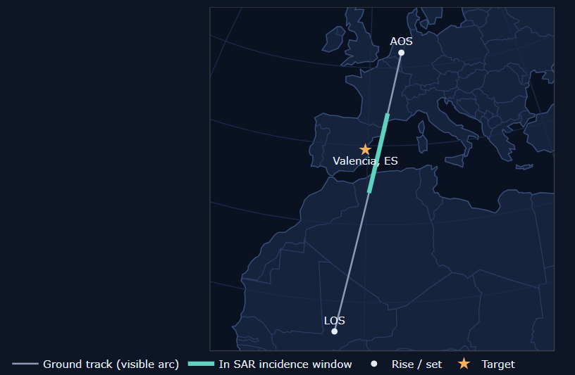

# SAR Pass & Doppler Simulator



Which SAR satellites can image a given point in the next 24 hours, from what incidence angle, and **what does the Doppler history of the carrier look like during the pass?**

Pick a target (default: Valencia, Spain), download the current orbital elements of a SAR constellation from [CelesTrak](https://celestrak.org) (ICEYE, X-band 9.65 GHz; or Sentinel-1, C-band 5.405 GHz), and get:

- every visibility pass in the next 24 h, with the sub-windows where the **incidence angle** is inside a configurable SAR range
- the two-way **Doppler shift** curve during each pass, its zero-crossing (zero-Doppler time = closest approach) and the **Doppler rate** there
- slant range, elevation, off-nadir angle, left/right looking side
- an interactive static web page (Plotly): Doppler curve, incidence/range plot, ground-track map in 2D and as a 3D globe, with a live carrier-frequency selector (L / C / X / Ku)

```
CelesTrak TLEs ──► SGP4 ──► ECEF state ──► geometry vs. target ──► passes + Doppler ──► docs/data/passes.json ──► web page
```

> **Live page:** `https://juanmuzzpila.github.io/sar-doppler-passes/` (after you enable GitHub Pages, see below)

## Quick start

```bash
git clone https://github.com/juanmuzzpila/sar-doppler-passes && cd sar-doppler-passes
python -m venv .venv && source .venv/bin/activate      # Windows: .venv\Scripts\activate
pip install -e ".[dev]"

pytest                                                  # 13 checks, < 1 s
python -m sarpass --mission iceye                       # real TLEs from CelesTrak, next 24 h over Valencia
python -m http.server -d docs 8000                      # open http://localhost:8000
```

Other targets / missions / constraints:

```bash
python -m sarpass --mission sentinel1 --lat 40.4168 --lon -3.7038 --name "Madrid"
python -m sarpass --inc-min 20 --inc-max 45 --hours 48
python -m sarpass --tle-file my_tles.txt                # your own TLEs
python -m sarpass --demo                                # synthetic constellation, no network
```

TLEs are cached in `.cache/` for 2 hours: CelesTrak asks clients not to re-download the same data more often. If the network is down the tool falls back to the last cached copy.

## The model, step by step

1. **Orbit** – SGP4 propagates each TLE (TEME frame). 1 s time step over the window.
2. **Earth-fixed frame** – rotate TEME → ECEF with GMST, and subtract the Earth's rotation from the velocity: `v_ecef = R·(v_teme − ω×r)`. A ground target is stationary in ECEF, so this *is* the relative velocity.
3. **Line of sight** – `u` = unit vector target → satellite, `R = |r_sat − r_tgt|`.
4. **Radial velocity** – `ṙ = u · v_ecef` (negative = approaching).
5. **Doppler** – two-way, monostatic:

   `f_D = −2 ṙ / λ = −2 f₀ ṙ / c`  (X-band: λ = 3.107 cm, so 1 m/s ≈ 64 Hz)

   Doppler rate near closest approach is `−2 f₀ r̈ / c`. For a straight-line pass this is the familiar `K_a ≈ −2 v² / (λ R₀)`, the azimuth chirp rate that SAR processing relies on.
6. **Incidence angle** – angle between `u` and the local ellipsoid normal at the target (flat terrain). Elevation = 90° − incidence. Off-nadir (look) angle is measured at the satellite against geodetic nadir.
7. **SAR-eligible window** – the part of a pass where incidence is within `[inc-min, inc-max]` (default 15°–50°). Near zenith there can be two windows, either side of closest approach.

Sanity check you can do by hand: at elevation 0° for a 570 km orbit, `sin(η) = R_E/(R_E+h)` gives a nadir angle of 66.6°, so `|ṙ| = v·cos(90° − η) ≈ 6.95 km/s` and `|f_D| ≈ 447 kHz` at X-band. The simulation gives ±445–452 kHz at the horizon of near-overhead passes.

## What is tested

`pytest` verifies the physics against independent references, not just against itself:

| Test | What it proves |
|---|---|
| `ṙ` from velocity = `d(range)/dt` from positions (< 1 m/s) | TEME→ECEF and Earth-rotation handling are consistent |
| Doppler changes sign at minimum range; approaching → positive | sign convention and zero-Doppler time |
| Horizon Doppler = closed form `v·cos(90°−η)` (within 10 %) | magnitude of the whole chain |
| Satellite directly overhead → incidence 0°, range = altitude | geometry |
| Geodetic ↔ ECEF round trip (mm level, LEO to GEO) | WGS84 conversions |
| TLE checksum, synthetic TLE altitude/period, SSO inclination | TLE parsing and demo generator |
| Incidence windows never exceed the configured limits | pass logic |

## Deploy as a web page (GitHub Pages)

1. Push the repo to GitHub.
2. **Settings → Pages → Build and deployment → Source: GitHub Actions**.
3. The workflow in `.github/workflows/pages.yml` runs the tests, downloads fresh TLEs, regenerates `docs/data/passes.json` and deploys, on every push and every 6 hours. If CelesTrak cannot be reached it deploys the synthetic demo data instead, and the page shows a banner saying so.

> The `docs/data/passes.json` committed in this repo was generated from the **synthetic demo constellation**, so the page works out of the box. Run the CLI or the workflow once to replace it with real data.

## Limitations (be upfront about these)

- **Educational model.** SGP4 from public TLEs is accurate to ~km, fine for visibility and Doppler shape, not for tasking.
- **Geometric Doppler of a stationary point.** Real SAR systems steer the beam (yaw/pitch steering, electronic steering) and process around a Doppler centroid; this tool shows the underlying geometry, not a specific sensor's steered Doppler.
- **Incidence window is an assumption**, not an operator spec. ICEYE modes (Spot, Strip, Scan, Dwell) have their own constraints; edit `--inc-min/--inc-max`.
- Flat terrain (ellipsoid), no attitude, no atmosphere (ionospheric/tropospheric delay), no collection scheduling or downlink constraints.
- CelesTrak's `NAME=` search is a substring match; objects with stale TLEs (> 30 days from the window start by default) are skipped and reported.

## Ideas to extend it

- Doppler **bandwidth over the synthetic aperture** vs. PRF: check azimuth ambiguity (PRF ≥ Doppler bandwidth).
- Add **squint**: Doppler centroid as a function of beam pointing off broadside.
- Compare **X-band (ICEYE) vs. C-band (Sentinel-1)** on the same target: azimuth chirp rate and resolution trade-offs.
- Range–Doppler "iso-lines" on the ground around the target.
- Terrain-aware local incidence angle with a DEM.

## Layout

```
src/sarpass/   geo.py (WGS84, frames) · tle.py · celestrak.py (cached download) · sar.py (geometry + Doppler)
               pipeline.py (JSON export) · demo.py (synthetic constellation) · cli.py
tests/         physics + parsing checks
docs/          static site: index.html · app.js · style.css · data/passes.json
.github/       CI + scheduled Pages deploy
```

## License

MIT. TLE data © CelesTrak / US Space Force, used under CelesTrak's terms.
